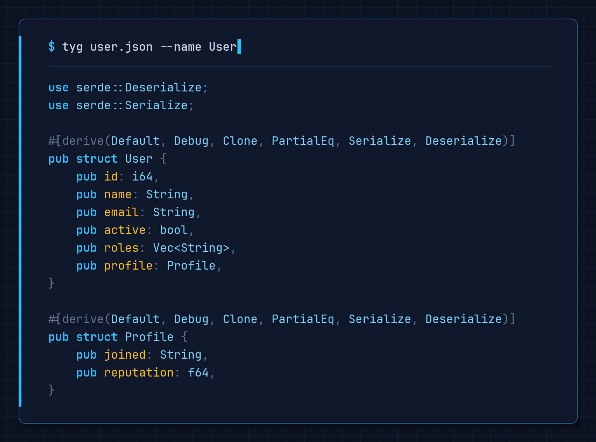
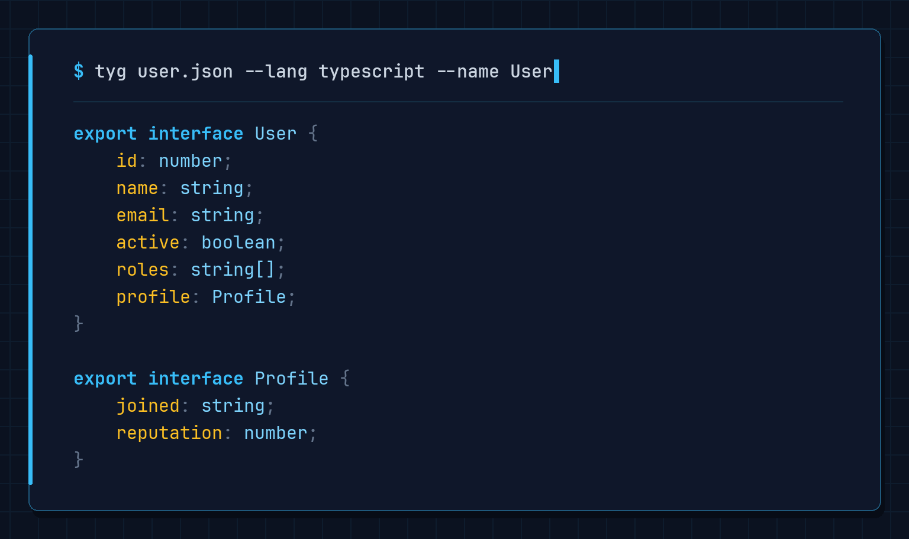
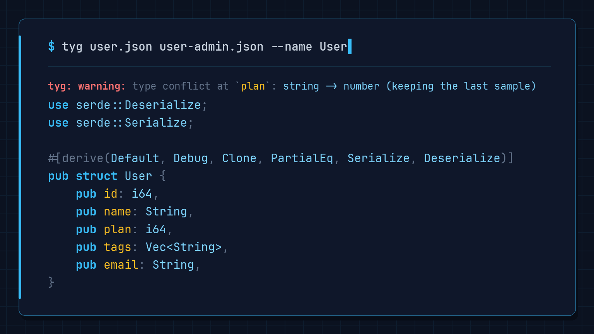

<div align="center">

# Type-Generator (`tyg`)

**Ergonomic CLI for json_typegen**

[](https://crates.io/crates/tyg)
[](https://github.com/SirCesarium/tyg/actions/workflows/ci.yml)
[](LICENSE)

</div>

`tyg` is an ergonomic CLI around [json_typegen](https://github.com/evestera/json_typegen). It reads the sources, merges the samples into one value, and passes that value to the engine. The code generation and the output modes come from json_typegen; `tyg` adds the input handling, the merge rules, and the flags.

```bash
tyg user.json
tyg user.json --name User --lang typescript
tyg config.yaml
tyg user.json user-admin.json --name User
tyg -u https://api.github.com/repos/SirCesarium/tyg
cat response.json | tyg --lang json-schema
```

Use it on API payloads and config files already in the project. Several samples merge into one shape.

### Example output

<div align="center">
  
</div>

## Input formats

| Format | Extension | Notes |
| --- | --- | --- |
| JSON | `.json` | Multiple values in one input merge into one sample. |
| YAML | `.yaml`, `.yml` | Documents separated by `---` merge into one sample. |
| TOML | `.toml` | One document per input. |
| XML | `.xml` | Attributes become keys, and element text goes under `#text`. |
| Properties | `.properties` | Values that parse as booleans or numbers become booleans or numbers. |

Files use the extension to select the parser. Files without a known extension parse as JSON. URLs parse as JSON unless `--format` is set. With no file paths and no URLs, `tyg` reads stdin as JSON.

## Output languages

| Output | Flag |
| --- | --- |
| Rust structs | `--lang rust` (default) |
| TypeScript interface | `--lang typescript` |
| TypeScript type alias | `--lang typescript-type-alias` |
| Kotlin with Jackson | `--lang kotlin-jackson` |
| Kotlin with kotlinx.serialization | `--lang kotlin-kotlinx` |
| JSON Schema | `--lang json-schema` |
| Shape summary | `--lang shape` |

The same sample with `--lang typescript`:

<div align="center">
  
</div>

## Merge rules

- Objects merge key by key, recursively.
- Arrays concatenate, so the element type covers every sample.
- A later scalar replaces an earlier one. When the types differ, `tyg` keeps the last sample and prints a warning to stderr.
- `null` leaves an existing value in place. A later non-null value replaces an earlier `null`.

Two samples merged, with the conflict warning on stderr:

<div align="center">
  
</div>

## CLI reference

```text
tyg [SOURCES]... [OPTIONS]
```

| Argument | Description |
| --- | --- |
| `[SOURCES]...` | File paths to read. The extension selects the format. |
| `-u, --url <URLS>` | Comma-separated URLs to fetch. Parsed as JSON unless `--format` is set. |
| `-f, --format <FORMAT>` | Force `json`, `yaml`, `toml`, `xml`, or `properties` for every source. |
| `-n, --name <NAME>` | Root type name. Defaults to `Root`. |
| `-l, --lang <LANG>` | Output language. Defaults to `rust`. |
| `-h, --help` | Print the help. |
| `-V, --version` | Print the version. |

Generated code goes to stdout, so redirect it into a file to keep it. Each URL request has 30 seconds to complete.

## Examples

A JSON sample on stdin:

```bash
$ echo '{"id": 1, "name": "Ada", "admin": false}' | tyg

use serde::Deserialize;
use serde::Serialize;

#[derive(Default, Debug, Clone, PartialEq, Serialize, Deserialize)]
pub struct Root {
    pub id: i64,
    pub name: String,
    pub admin: bool,
}
```

Two samples that disagree on a field:

```bash
tyg user.json user-admin.json --name User
```

```text
tyg: warning: type conflict at `plan`: string -> number (keeping the last sample)
```

The generated code follows on stdout; the warning goes to stderr.

## Downloads

The binaries are uploaded into the [releases](https://github.com/SirCesarium/tyg/releases) section of the GitHub repository. You can download the latest version of `tyg` for your platform from there.

### Quick downloads

<div align="center">

<a href="https://github.com/SirCesarium/tyg/releases/latest/download/tyg-windows-x86_64.msi"></a>
<a href="https://github.com/SirCesarium/tyg/releases/latest/download/tyg-linux-amd64.deb"></a>
<a href="https://github.com/SirCesarium/tyg/releases/latest/download/tyg-linux-x86_64.rpm"></a>
<a href="https://github.com/SirCesarium/tyg/releases/latest/download/tyg-macos-arm64"></a>

</div>

The Windows, Debian, and Fedora buttons download installers; macOS downloads the standalone binary. If you have an uncommon architecture (like `Linux ARM64`) you can check the [releases](https://github.com/SirCesarium/tyg/releases) page.

Or even check the [Installation](#installation) section.

## Installation

First, **make sure** you have the **Rust Programming Language** installed on your machine, if not, [click here](https://rust-lang.org/).

### Install with cargo

- Run `cargo install tyg` and you're good to go!

### Build from source

- Clone the repository `git clone https://github.com/SirCesarium/tyg.git` and navigate to the `tyg` directory.
- Install `tyg` with `cargo install --path .`.

## Development

### Requirements

- Rust 1.99 or newer, with the `clippy` and `rustfmt` components: `rustup component add clippy rustfmt`.

### Build and run

- Clone the repository `git clone https://github.com/SirCesarium/tyg.git` and navigate to the `tyg` directory.
- Build the binary with `cargo build`. The debug binary lands in `target/debug/tyg`.
- Run it from the checkout: `cargo run -- user.json --name User`.

### Checks

CI runs clippy and the test suite on every push and pull request:

```bash
cargo clippy --tests -- -D warnings
cargo test
```

Format the code with `cargo fmt`.

`Cargo.toml` denies `unwrap_used`, `expect_used`, and `absolute_paths` in clippy. The integration tests allow the first two explicitly.

The tests in `tests/integration.rs` run the compiled binary against stdin, files, and a local HTTP server.

### Layout

| Path | Responsibility |
| --- | --- |
| `src/cli.rs` | Argument parsing and defaults |
| `src/input.rs` | File, URL, and stdin sources |
| `src/format.rs` | Format detection and parsing |
| `src/merge.rs` | Sample merging and conflict reporting |
| `src/codegen.rs` | json_typegen call and output mode mapping |
| `src/error.rs` | CLI errors |

The generation engine is [json_typegen](https://github.com/evestera/json_typegen), dual-licensed MIT/Apache-2.0.

## License

Distributed under the [MIT License](LICENSE).
